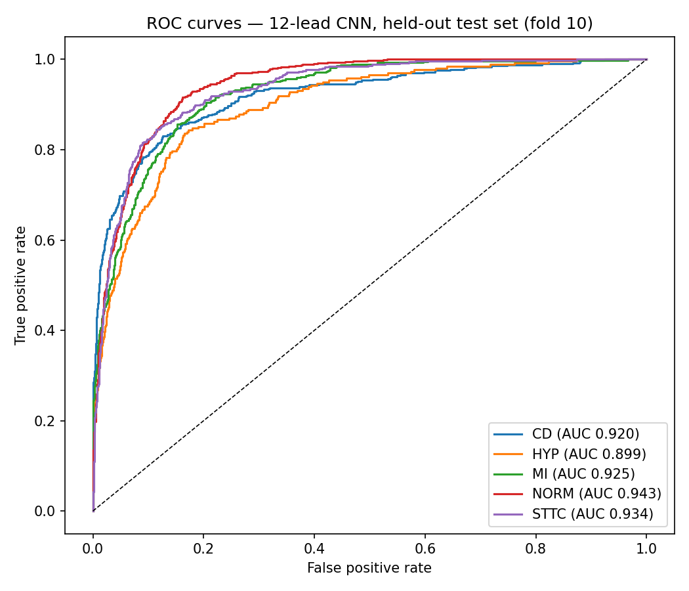
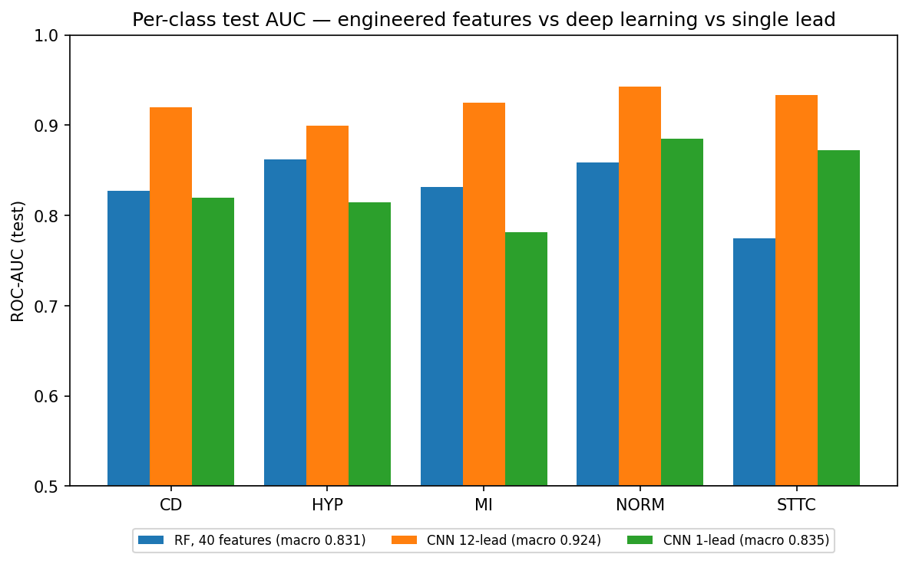

# ECG Classification on PTB-XL — Engineered Features vs. Deep Learning

Multi-label classification of 12-lead ECGs into the 5 PTB-XL diagnostic superclasses (NORM, MI, STTC, CD, HYP), designed as a controlled comparison between two paradigms on identical official splits — plus a single-lead ablation quantifying the ceiling of smartwatch-style ECG screening.

## Results at a glance

- **Macro ROC-AUC 0.924** on the held-out test set (official fold 10) with a compact 1D CNN — in line with published PTB-XL benchmarks (≈0.92–0.93)
- The 12-lead CNN beats a random forest on 40 engineered signal features by **+0.093 macro-AUC**, with the gap concentrated exactly where hand-coded features are blind (ST/T morphology: +0.159)
- Restricting input to a single lead (smartwatch-style, lead I) costs **−0.089 macro-AUC**, with inferior myocardial infarction as the worst case (**−0.143**) — a ceiling set by electrode geometry, not by the model

> **Disclaimer**: educational portfolio project. Not a medical device.

## Background

Practical implementation of the topic of my BSc thesis (*"Machine learning techniques for the analysis of cardiac pathologies from electrocardiography data"*, University of Padova), and the follow-up to my [tabular heart-disease project](https://github.com/harjoldbrahimaj/heart-disease-prediction) on the UCI dataset — from clinical tables to raw signals.

## Dataset

[PTB-XL v1.0.3](https://physionet.org/content/ptb-xl/1.0.3/) (PhysioNet, open access): 21,799 clinical 12-lead ECGs, 10 s at 100 Hz, annotated by cardiologists with SCP-ECG statements. Diagnostic codes aggregated into 5 superclasses via the official mapping; 411 records without diagnostic labels excluded; final N = 21,353 (35 records, 0.16%, discarded at feature extraction after verifying discards were scattered, not class-concentrated).

The task is genuinely **multi-label**: ~24% of ECGs carry 2+ simultaneous diagnoses. Target = binary matrix (N × 5), model = 5 independent binary outputs (`BCEWithLogitsLoss` / one-vs-rest).

**Splits**: official patient-stratified folds (1–8 train / 9 validation / 10 test), which prevent patient-level leakage (same patient never in train and test) and make results directly comparable with published benchmarks.

## Methods

**Phase A — feature engineering + classical ML.** NeuroKit2 preprocessing (band-pass cleaning, R-peak detection); 40 features per ECG (rhythm from lead II: HR, RR statistics; per-lead R amplitudes; per-lead std / peak-to-peak). Logistic regression (one-vs-rest, standardized, leakage-free `Pipeline`) and random forest (300 trees).

**Phase B — 1D CNN on raw waveforms.** PyTorch; 4 convolutional blocks (Conv1d k=7 → BatchNorm → ReLU → MaxPool), global average pooling, linear head; ~200k parameters; Adam 1e-3, batch 128, 15 epochs on a Colab T4; per-lead standardization with training statistics only; best-on-validation checkpointing.

**Ablation — lead I only.** Same architecture and training with input restricted to the single lead a smartwatch approximately records.

## Results (held-out test set, fold 10, ROC-AUC)

| class | RF (40 features) | CNN 12-lead | gap | CNN 1-lead | vs 12-lead |
|---|---|---|---|---|---|
| CD   | 0.828 | 0.920 | +0.092 | 0.819 | −0.101 |
| HYP  | 0.862 | 0.899 | **+0.037** | 0.814 | −0.085 |
| MI   | 0.831 | 0.925 | +0.094 | 0.782 | **−0.143** |
| NORM | 0.858 | 0.943 | +0.085 | 0.885 | −0.058 |
| STTC | 0.775 | 0.934 | **+0.159** | 0.873 | −0.061 |
| **macro** | **0.831** | **0.924** | **+0.093** | **0.835** | **−0.089** |

Validation: LogReg 0.816, RF 0.844, CNN 0.929 (epoch 12; epochs 13–15 showed decreasing loss with declining val AUC — overfitting onset handled by checkpointing). Test macro-AUC 0.924 is in line with published PTB-XL benchmarks (≈0.92–0.93).

*Both figures are generated by section 10 of the notebook.*

## The three findings

**1. Engineered features reach exactly as far as the knowledge encoded in them.** HYP is their best class (voltage criteria = amplitude features); STTC their worst (fine ST/T morphology invisible to coarse features). Pre-registered before training the CNN, confirmed by the gap column: largest on STTC (+0.159), smallest on HYP (+0.037). Deep learning pays where hand-coded knowledge stops — and barely pays where it didn't.

**2. A compact CNN matches the literature.** ~200k parameters, no hyperparameter search, benchmark-range performance. Unlike the small-data tabular project (where logistic regression tied the forest and won on parsimony), 17k training examples justify model complexity — the dataset decides, not ideology.

**3. The single-lead ceiling is physics, not algorithms.** MI loses the most (−0.143): lead I measures the cardiac vector's projection on the horizontal axis, while inferior infarction vectors point downward — nearly orthogonal, so the signal never reaches the electrode. No model recovers information that isn't acquired. Single-lead screening is viable selectively (NORM, STTC ≈ −0.06), inferior MI remains structurally hard from the wrist.

## Limitations

Labels are cardiologist statements, not angiography-confirmed ground truth; superclass aggregation hides within-class heterogeneity; single data source, no external validation; deliberately simple v1 feature set (no QRS delineation, no frequency-domain HRV); single architecture, single seed, no tuning; thresholds not calibrated (results are rankings, not operating points); class imbalance (HYP) handled only implicitly.

## Possible extensions

Delineation/wavelet features for Phase A; residual architectures and data augmentation for Phase B; per-class threshold calibration; external validation (e.g. Chapman-Shaoxing); saliency-based interpretability (which waveform samples drive each diagnosis).

## Repository structure

| Path | Description |
|---|---|
| `ptbxl_ecg_classification.ipynb` | The full analysis: download → labels → preprocessing → Phase A (features + classical ML) → Phase B (CNN) → single-lead ablation → figures |
| `README.md` | This file |
| `roc_curves_test.png`, `auc_by_class.png` | ROC curves and per-class AUC comparison (generated by notebook section 10) |
| *(on Google Drive, not in repo)* `ptbxl/records100/` | Raw 100 Hz signals downloaded from PhysioNet (~600 MB) |
| *(on Google Drive)* `ptbxl/features_v1.csv` | Cached engineered features (21,353 × 40) |
| *(on Google Drive)* `ptbxl/signals_100hz.npy`, `signals_ids.npy` | Cached signal tensor (21,353 × 1000 × 12, ~1 GB) and record IDs |
| *(on Google Drive)* `ptbxl/cnn_best.pt`, `cnn_1lead_best.pt` | Best-on-validation model checkpoints (12-lead and 1-lead CNN) |

Data and cached artifacts stay on Drive (PhysioNet data should not be redistributed in the repo; the notebook re-downloads everything reproducibly).

## Stack & reproducibility

Python, wfdb, NeuroKit2, pandas, scikit-learn, PyTorch, Google Colab (T4). Official PTB-XL splits, fixed seeds, cached artifacts (features CSV, signal tensor, model checkpoints) on Google Drive. Open `ptbxl_ecg_classification.ipynb` in Colab (GPU runtime for Phase B); the first run downloads the dataset (~600 MB) to your Drive. In the saved notebook the two training loops are shown but not re-executed: the best-on-validation checkpoints are reloaded to reproduce every reported number exactly. To retrain from scratch, simply run those cells as well.

## References

- Wagner et al., *PTB-XL, a large publicly available electrocardiography dataset*, Scientific Data (2020)
- Strodthoff et al., *Deep Learning for ECG Analysis: Benchmarks and Insights from PTB-XL*, IEEE JBHI (2021)
